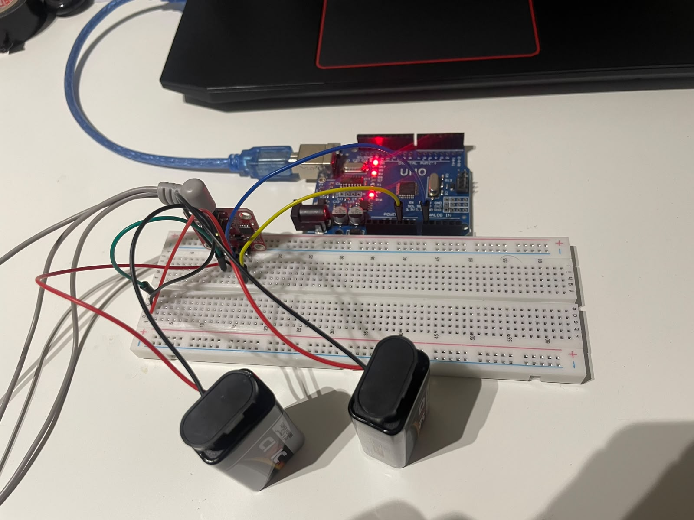
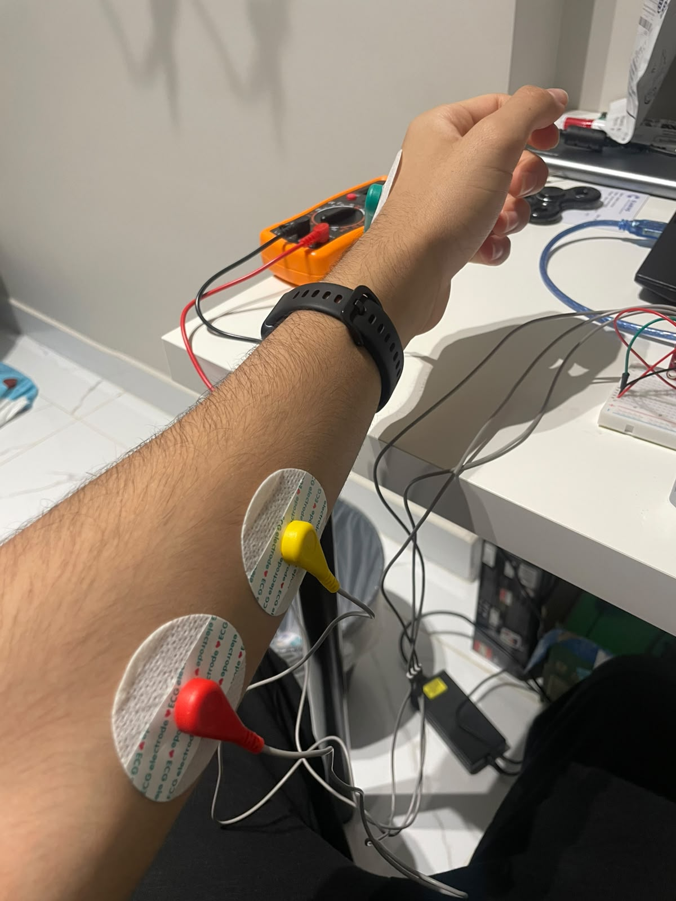

# EMG Hand: a virtual hand controlled by muscle signals

**A sensor on my forearm reads how hard I'm squeezing, and a 3D hand on screen opens and closes to match, in real time.**

> **Status: working proof of concept.** It uses one EMG channel, so it tracks one movement (open hand ↔ closed fist) and how strongly I'm making it. It can't yet tell individual fingers or different gestures apart. See [Future improvements](#future-improvements).

## Demo

▶️ **[Watch the demo video on YouTube](PASTE_YOUTUBE_LINK_HERE)**

> ✏️ **PASTE HERE:** replace `PASTE_YOUTUBE_LINK_HERE` in the line above with your unlisted YouTube link (for example `https://youtu.be/abc123XYZ`), then delete this note.


*The circuit. The Arduino Uno (top) reads the small red EMG sensor board on the breadboard, which runs from the two 9 V batteries (front). The grey cable on the left goes to the electrodes.*


*ECG electrode pads on my forearm, clipped to the sensor's lead cable. In the background is the multimeter I used to check the supply voltages.*

## How it works

When a muscle contracts, its fibres produce tiny electrical voltages, a few thousandths of a volt, that can be picked up through the skin. This is called **EMG (electromyography)**. The harder you squeeze, the more fibres fire and the bigger the signal gets.

1. **Pick up the signal.** Three sticky electrodes go on my forearm: two over the muscles that close my hand, and one reference electrode on a spot with little muscle activity.
2. **Amplify and clean it.** The sensor board measures the tiny difference between the two muscle electrodes, amplifies it many times over, and smooths it into a single voltage that rises the harder I squeeze.
3. **Measure it.** The Arduino Uno reads that voltage on pin A0 about 100 times a second, as a number from 0 to 1023, and sends each number to the computer over USB.
4. **Turn it into a grip level.** A browser app reads the numbers, smooths out the jitter, and converts them into a 0–100% "grip" using a quick calibration: 3 seconds relaxed (my resting level becomes 0%), then 3 seconds of a firm clench (my maximum becomes 100%). A small dead-zone just above resting level stops background noise from twitching the fingers.
5. **Move the virtual hand.** The grip level sets the angle of every finger joint on a 3D hand model, so a half-strength squeeze gives a half-closed hand. The fingers follow through a spring-like filter so the motion is smooth, and they close pinky-first with the thumb wrapping last, like a real grip.

```
forearm muscle ─► ECG electrode pads ─► EMG sensor board ─► Arduino Uno (pin A0)
                                                                 │
                                                                 │ USB, ~100 numbers per second
                                                                 ▼
     3D hand on screen ◄── finger joint angles ◄── 0–100% grip ◄── browser app
```

**What it can't do (yet):** one sensor measures the *overall effort* of the muscles under the electrodes, not the position of each finger. If I pinch or move one finger, the virtual hand simply closes all its fingers by that amount.

## Hardware

| Part | Role in the project |
|---|---|
| Arduino Uno | Reads the sensor board's output on analog pin A0 and sends the values to the computer over USB. |
| ESP32-S3 | ✏️ PASTE HERE: what the ESP32-S3 does in your build |
| Red EMG muscle sensor board (✏️ PASTE HERE: model name, if known) | Amplifies and filters the muscle signal and outputs a smooth voltage that rises with effort. |
| ECG electrode pads (3: two on the muscle, one reference) | Disposable stick-on gel pads that pick up the signal through the skin ([why ECG pads?](#a-note-on-the-electrodes)) |
| 2 × 9 V batteries in series | Dual ±9 V power supply for the sensor board ([why?](#challenges-and-what-i-learned)) |
| Multimeter | Checking the supply voltages |
| Laptop with Chrome or Edge | Runs the virtual hand app. Chrome and Edge can read USB serial ports; Firefox and Safari can't. |
| ✏️ PASTE HERE: anything else (jumper wires, 9 V battery clips, breadboard…) | |

### Wiring

| From | To |
|---|---|
| Battery A **+** | Sensor board **+V** (+9 V) |
| Battery A **−** joined to Battery B **+** (the midpoint) | Sensor board **GND** *and* Arduino **GND** |
| Battery B **−** | Sensor board **−V** (−9 V) |
| Sensor board **signal output** | Arduino **A0** |
| Electrode leads | Sensor board electrode inputs (two muscle electrodes + one reference) |

> ✏️ **CHECK:** make sure this table matches how you actually wired it, and use the pin names printed on your board.

> **Safety:** everything connected to the body runs from batteries. While the electrodes are on, the laptop should run on its own battery with the charger unplugged, so there's no route from mains power through the USB cable to the body.

## The build

1. **Power first.** I built a dual supply from two 9 V batteries in series (how and why are under [Challenges](#challenges-and-what-i-learned)) and checked it with a multimeter before connecting anything else.
2. **Sensor to Arduino.** The sensor's output goes to A0, and the battery midpoint goes to both the sensor's GND and the Arduino's GND. The Arduino measures voltages relative to its own ground, so both boards need to share the same 0 V point.
3. **Electrodes.** ✏️ PASTE HERE: where you placed the pads (for example "two along the inner forearm a few centimetres below the elbow, reference on the bony part of the elbow") and how you prepared the skin.
4. **Arduino code** ([`arduino/emg_sender/emg_sender.ino`](arduino/emg_sender/emg_sender.ino)). The sketch is deliberately tiny: read A0, print the number, wait 10 ms, repeat. About 100 readings a second is enough for smooth motion and uses roughly 6,000 of the 9,600 bits per second the serial link can carry. Keeping the Arduino side simple means all the signal processing can be tuned in the app without re-uploading code.
5. **Check the raw signal.** The Arduino IDE's Serial Plotter graphs the numbers live. It's the quickest way to see whether the sensor is working before the app gets involved.
6. **Virtual hand app** ([`index.html`](index.html) and [`js/`](js)). It runs in Chrome or Edge, uses the Web Serial API to read the Arduino directly over USB, and draws the 3D hand with [three.js](https://threejs.org/).
   - [`js/serial.js`](js/serial.js): connects to the USB port and reads one number per line
   - [`js/signal.js`](js/signal.js): smoothing (an exponential moving average), calibration, and scaling to 0–100%
   - [`js/hand.js`](js/hand.js): the 3D scene and the finger joint angles
   - [`js/app.js`](js/app.js): ties it all together, with the controls, the calibration steps and a live signal chart

   The app was built with the help of Claude, an AI coding assistant (see [Credits](#credits)).

   > ✏️ **PASTE HERE:** your part in the app, in your own words (for example what you asked it to do, what you tested with your own hardware, and what you changed or tuned).

### Run it yourself

You can try it **without any hardware**:

1. Download this repository (green **Code** button → **Download ZIP**) and unzip it.
2. On Windows, double-click **`Start EMG Hand.bat`**. It starts a small local web server and opens the app in Edge or Chrome. An internet connection is needed to load the 3D libraries.
3. Tick **Demo mode** and hold **Space** to simulate a clench.

With the hardware: upload the sketch, close the Arduino IDE's Serial Monitor/Plotter (only one program can use the port at a time), click **Connect** in the app, and follow the on-screen calibration. Settings and troubleshooting are in the [software guide](docs/software-guide.md).

## Challenges and what I learned

### The problem: no signal

After wiring everything up, the Serial Plotter showed no usable signal. ✏️ PASTE HERE: what you actually saw (for example "a flat line near 0 that didn't change when I clenched"). ✏️ PASTE HERE: how the sensor board was powered at that point.

### Working out why

The amplifiers on this type of sensor board need a **dual supply**: a positive rail, a negative rail, and a 0 V ground in between. The raw muscle signal swings both above and below 0 V, and the amplifiers need room on both sides to follow it. Without the negative rail, the board can't produce a usable output.

✏️ PASTE HERE: how you figured this out (datasheet, a forum post, a teacher, trial and error…).

### The fix: a dual supply from two 9 V batteries

Connecting two 9 V batteries in series (the **−** of one to the **+** of the other) gives 18 V across the pair. If the joint in the middle is treated as ground (0 V), that splits into **+9 V** and **−9 V**:

```
Battery A (+) ─────────────────►  +9 V  → sensor +V
Battery A (−) ──┐
                ├──────────────►   0 V  → sensor GND and Arduino GND
Battery B (+) ──┘
Battery B (−) ─────────────────►  −9 V  → sensor −V
```

### Verifying it, in two steps

1. **Multimeter, before connecting the board.** With the black probe on the midpoint (ground), I measured each rail with the red probe: ✏️ PASTE HERE: your readings (for example "+9.4 V and −9.3 V"). A minus sign on the negative rail confirms the batteries are connected the right way round.
2. **Serial Plotter, with everything connected.** The live trace now stayed low and steady at rest and rose clearly each time I clenched: ✏️ PASTE HERE: rough numbers (for example "about 40 at rest, 400–600 when clenching"). That clear gap between rest and clench is exactly what the app's calibration relies on.

### What I learned

- **Check the power before blaming the circuit.** The sensor could be wired correctly and still output nothing if it isn't powered the way it needs.
- **Measure, don't assume.** A multimeter takes seconds and turns "I think it's wired right" into numbers.
- **Test one stage at a time.** Checking the supply voltages, then the raw signal, then the app made it clear which stage a problem was in.
- ✏️ PASTE HERE: anything else you learned, in your own words.

## A note on the electrodes

I used **ECG electrodes**, the stick-on pads used for heart monitoring, rather than dedicated EMG electrodes. They're the same basic kind of sensor (a disposable pad with conductive gel), they pick up muscle signals through the skin well enough for this project, and they're cheap and easy to buy.

The trade-offs:

- They're often larger than dedicated EMG electrodes, so they pick up activity from a wider area, including neighbouring muscles.
- They're single-use. Once the gel dries, or a pad is peeled off and re-stuck, the signal gets noisier.
- Moving them even a little changes the signal strength, which is why the app calibrates every time it connects.

## Future improvements

- **More channels, more gestures.** Add 2–4 sensors over different forearm muscles (for example the ones that open the hand as well as the ones that close it) and train a simple classifier, so it can tell a fist, a pinch and a point apart.
- **Go wireless.** Stream the readings over Bluetooth or Wi-Fi (for example from an ESP32-S3) instead of a USB cable.
- **A better power supply.** 9 V batteries run down fairly quickly, and their voltage drops as they drain. A rechargeable, regulated ±V supply would be steadier and cheaper over time.
- **Faster sampling.** 100 readings per second is fine for the smoothed signal, but analysing the raw EMG waveform (for example its frequency content, which shifts as a muscle tires) would need about 1,000 or more per second and a faster serial link.
- **Put numbers on performance.** Measure the delay from muscle activation to on-screen movement, and how repeatable the grip level is between sessions.
- **Control something physical.** Use the same grip level to drive servos in a 3D-printed robotic hand, a first step toward how myoelectric prosthetic hands work.

## Credits

- Hardware, wiring and Arduino code: me.
- Browser app (`index.html`, `style.css`, `js/`, and the helper scripts): built with Claude, an AI coding assistant made by Anthropic.
- 3D hand model: the WebXR "generic hand" from the open-source [webxr-input-profiles](https://github.com/immersive-web/webxr-input-profiles) project (MIT license).
- 3D rendering: [three.js](https://threejs.org/) (MIT license).
