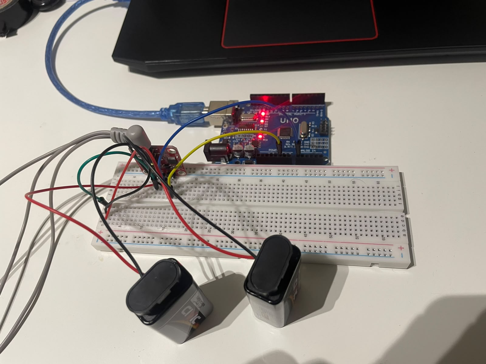
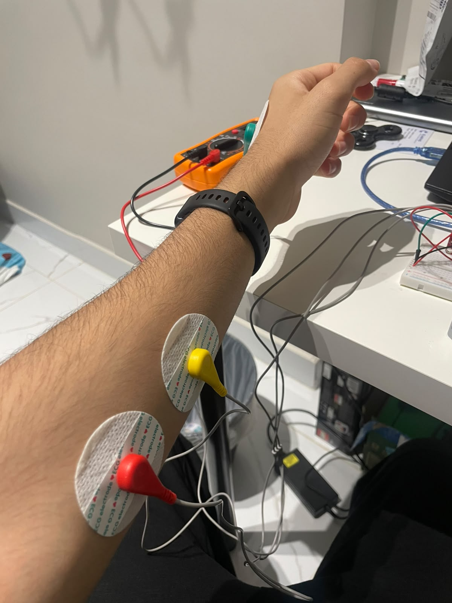

# EMG Hand: a virtual hand controlled by muscle signals

**A sensor on my forearm reads how hard I'm squeezing, and a 3D hand on screen opens and closes to match, in real time.**

> **Two versions live in this repository.**
> - **Mark I** (finished): one EMG channel, so it tracks one movement (open hand ↔ closed fist) and how strongly I'm making it. Most of this README describes it, starting at [How it works](#how-it-works).
> - **Mark II, "Demon's Dark Hand"**: three sensors, one per finger group, so the thumb, the index + middle fingers and the ring + pinky fingers move separately. See [Mark II](#mark-ii-demons-dark-hand). The app runs both: pick one under **Sensor setup**.

**Try it:** [live demo in your browser](https://yamimah0849-dot.github.io/emg-hand/) (Chrome or Edge; no sensor needed, just tick **Demo mode** and hold **Space**; in Mark II, keys **1**, **2** and **3** flex each finger group) · [demo video](https://youtube.com/shorts/HJ0MSKtzvS0)

## My role

- **Built the hardware:** wired the EMG sensor board, electrodes and Arduino Uno, plus a ±9 V dual supply made from two 9 V batteries.
- **Debugged it:** the board first gave no signal at all. The cause turned out to be the power supply, so I built the dual supply and checked the fix with a multimeter and the Serial Plotter ([details](#challenges-and-what-i-learned)).
- **Wrote the Arduino code** that streams the sensor readings to the computer.
- **Directed, tested and tuned the browser app**, which was built with the help of Claude, an AI coding assistant ([details](#the-build)).

## Demo

[](https://youtube.com/shorts/HJ0MSKtzvS0)

▶️ **[Watch the demo video on YouTube](https://youtube.com/shorts/HJ0MSKtzvS0)**


*The circuit. The Arduino Uno (top) reads the small red EMG sensor board on the breadboard, which runs from the two 9 V batteries (front). The grey cable on the left goes to the electrodes.*


*ECG electrode pads on my forearm, clipped to the sensor's lead cable. In the background is the multimeter I used to check the supply voltages.*

## Mark II: Demon's Dark Hand

Mark II adds two more sensors so each finger group gets its own channel:

| Sensor | Arduino pin | Moves |
|---|---|---|
| Sensor 1 | A0 | Thumb |
| Sensor 2 | A1 | Index + middle fingers |
| Sensor 3 | A2 | Ring + pinky fingers |

What's new in the app:

- **Finger groups:** each sensor drives its own fingers, smoothly and in proportion to how hard that muscle works (half the effort gives a half-bent finger).
- **Live signal view** (the **Signals** tab, or press **V**): three labelled lanes, one per sensor, each with a scrolling graph, the live number and an activity bar. The lane that's moving the hand lights up, so you can see at a glance which sensor reacts to which finger. It replaces the Arduino IDE's Serial Plotter.
- **Per-sensor calibration:** records each sensor's resting level and its maximum flex, and saves them in the browser, so you only redo it when you move the pads.
- **Crosstalk filter:** forearm muscles sit close together, so each sensor also picks up a bit of its neighbours (that's called crosstalk). Each sensor has a threshold slider: its fingers only move once it rises above the threshold. Calibration measures the crosstalk and suggests a threshold for each sensor.
- **Demon look:** dark charcoal skin, sharp claws, and red veins that glow brighter the harder you flex (only on the fingers you're flexing). A switch under **Appearance** brings back the normal hand.

### Mark II wiring

The signal side is the same idea as Mark I, three times over. Every sensor's signal goes to its own analog pin, and every sensor shares the Arduino's ground.

| From | To |
|---|---|
| Sensor 1 **SIG** | Arduino **A0** |
| Sensor 2 **SIG** | Arduino **A1** |
| Sensor 3 **SIG** | Arduino **A2** |
| Every sensor's **GND** (beside SIG) | Arduino **GND** (one shared ground, e.g. a ground row on the breadboard) |
| Each sensor's electrode cable | That sensor's 3.5 mm socket |

**Power:** power each sensor board the way [Mark I's wiring](#wiring) does. If all three are the same red ±9 V boards, they can share one battery pair: connect every board's **+Vs** to battery A **+**, every board's **−Vs** to battery B **−**, and every board's **GND** (beside +Vs and −Vs) to the batteries' midpoint. Three boards drain the batteries faster than one, so if the signals get weak, check the voltages with the multimeter.

```
                         ┌──────────────────────────┐
Sensor 1 SIG ───────────►│ A0                       │
Sensor 2 SIG ───────────►│ A1      Arduino Uno      │ USB ──► laptop
Sensor 3 SIG ───────────►│ A2                       │
All sensor GNDs ────────►│ GND                      │
                         └──────────────────────────┘
```

> **Safety:** the same rule as Mark I applies. Everything touching your body runs from batteries, and the laptop runs on its own battery with the charger unplugged while the electrodes are on.

### Where to put the electrodes

Each sensor needs its own three pads: two over the muscle, plus one reference pad on a bony spot with little muscle (the back of the wrist or the bony point of the elbow). The muscles that bend your fingers are on the palm side of the forearm. Good starting spots:

- **Sensor 1 (thumb):** on the thumb side of the inner forearm, about halfway between elbow and wrist.
- **Sensor 2 (index + middle):** in the middle of the inner forearm, about a third of the way down from the elbow.
- **Sensor 3 (ring + pinky):** on the pinky side of the inner forearm, about a third of the way down from the elbow.

Put each sensor's two muscle pads close together, one above the other along the arm, and keep the three sensors' pads as far from each other as the space allows. Then use the app's **Signals** view to move them until each sensor reacts most to its own fingers. They won't be perfectly separate, and that's what the crosstalk filter is for.

### Step by step: from zero to a moving hand

**1. Install the Arduino IDE** (once). Download it from [arduino.cc/en/software](https://www.arduino.cc/en/software) and install it.

**2. Get this project onto your computer.** On the GitHub page, click the green **Code** button → **Download ZIP**, then unzip it. (If Mark II hasn't been merged into `main` yet, first switch GitHub's branch menu from `main` to `mark-ii`.)

**3. Upload the Mark II sketch to the Arduino.**
1. Plug the Arduino into the laptop with the USB cable.
2. In the Arduino IDE, choose **File → Open** and open `arduino/emg_sender_v2/emg_sender_v2.ino` from the unzipped folder.
3. Choose **Tools → Board → Arduino AVR Boards → Arduino Uno**.
4. Choose **Tools → Port** and pick the port marked *Arduino Uno* (on Windows it's called something like *COM3*). If you don't see it, try another USB cable: some can only charge.
5. Click the round **Upload** button with the right-pointing arrow (→) at the top left. Wait until the bottom of the window says **Done uploading**.
6. Optional check: open **Tools → Serial Monitor**, set the speed in its corner to **115200 baud**, and you should see lines of three numbers like `38,41,35` scrolling past. Flex a finger and one of them should jump up.
7. **Close the Serial Monitor and Serial Plotter** (or the whole IDE). Only one program can use the Arduino's port at a time, and the app needs it.

**4. Start the app.** On Windows, double-click **`Start EMG Hand.bat`** in the unzipped folder. It opens the app in Edge or Chrome (other browsers can't talk to USB serial ports). Keep the small black console window open while you use it.

**5. Connect.**
1. Under **Sensor setup**, choose **Mark II: 3 sensors**. The **Baud rate** switches to **115200**, which matches the sketch.
2. Click **Connect**, pick your Arduino in the list that pops up, and click *Connect* there.
3. The status at the top right turns green: **Connected**.

**6. Check the sensors in the Signals view.** Click the **Signals** tab (or press **V**). Move one finger group at a time: bend your thumb, then curl your index and middle fingers, then your ring and pinky. The matching lane should rise the most and light up. If the wrong lane reacts, or none does, move that sensor's pads (and see the troubleshooting table below).

**7. Calibrate.** Press **Calibrate all sensors** (or **C**) and follow the card on screen. It takes about 20 seconds:
1. Relax your arm for 3 seconds (records every sensor's resting level).
2. Bend your thumb firmly into your palm and hold for 3 seconds (sensor 1's maximum).
3. Curl your index and middle fingers and hold (sensor 2's maximum).
4. Curl your ring and pinky fingers and hold (sensor 3's maximum).

The calibration is saved. Next time, just click **Connect** and go. If you move one sensor's pads, press **Redo** next to just that sensor.

**8. Reduce crosstalk.** After calibrating, the **Crosstalk filter** section shows how much each sensor picked up from the other fingers and suggests a threshold. Press **Use suggested thresholds**, then try moving each finger group. If a group still twitches when you move other fingers, drag its slider up a little. If it feels hard to move, drag it down.

**9. Play.** Switch back to the **3D hand** tab. Flex and watch the demon hand follow, veins glowing. To get the normal hand back, turn off **Demon hand** under **Appearance** (or click one of the skin colours).

**Using the Mark I hardware again:** upload `arduino/emg_sender/emg_sender.ino` instead, and choose **Mark I: 1 sensor** under *Sensor setup* (the baud rate switches to 9600). Everything works as before.

### Mark II troubleshooting

| Symptom | Fix |
|---|---|
| "No numbers are arriving" | The baud rate must be **115200** for the Mark II sketch. Check that the sketch actually uploaded (step 3). |
| The app says the Arduino is sending **one** value per line | The Arduino still has the Mark I sketch on it. Upload `emg_sender_v2` (step 3). |
| One lane stays flat | Check that sensor's SIG wire goes to the right pin, its GND goes to the Arduino's GND, its power wires are connected, and its pads are stuck down firmly. |
| All three lanes rise together whatever you move | The pads are too close together or over the same muscle. Spread them out (see *Where to put the electrodes*), recalibrate, then use the suggested thresholds. |
| A lane jumps around while you're relaxed | A pad is loose or its gel has dried. Use fresh pads, then press **Redo** for that sensor. |
| A full flex reads 1023 and goes flat at the top | That sensor's gain is too high: turn its board's gain trimmer down a little (see [Future improvements](#future-improvements)). |

The [software guide](docs/software-guide.md) explains every setting in more detail.

## How it works

*This section and the ones after it describe Mark I, the original one-sensor build. Mark II works the same way, with three channels instead of one.*

When a muscle contracts, its fibres produce tiny electrical voltages, a few thousandths of a volt, that can be picked up through the skin. This is called **EMG (electromyography)**. The harder you squeeze, the more fibres fire and the bigger the signal gets.

1. **Pick up the signal.** Three sticky electrodes go on my forearm: two over the muscles that close my hand, and one reference electrode on a spot with little muscle activity.
2. **Amplify and clean it.** The sensor board measures the tiny difference between the two muscle electrodes, amplifies it many times over, and smooths it into a single voltage that rises the harder I squeeze.
3. **Measure it.** The Arduino Uno reads that voltage on pin A0 about 100 times a second, as a number from 0 to 1023, and sends each number to the computer over USB.
4. **Turn it into a grip level.** A browser app reads the numbers, smooths out the jitter, and converts them into a 0–100% "grip" using a quick calibration: 3 seconds relaxed (my resting level becomes 0%), then 3 seconds of a firm clench (my maximum becomes 100%). A small dead-zone just above resting level stops background noise from twitching the fingers.
5. **Move the virtual hand.** The grip level sets the angle of every finger joint on a 3D hand model, so a half-strength squeeze gives a half-closed hand. The fingers follow through a spring-like filter so the motion is smooth, and they close pinky-first with the thumb wrapping last, like a real grip.

```
forearm muscle ─► ECG electrode pads ─► EMG sensor board ─► Arduino Uno (pin A0)
                                                                 │
                                                                 │ USB, ~100 numbers per second
                                                                 ▼
     3D hand on screen ◄── finger joint angles ◄── 0–100% grip ◄── browser app
```

**What it can't do (yet):** one sensor measures the *overall effort* of the muscles under the electrodes, not the position of each finger. If I pinch or move one finger, the virtual hand simply closes all its fingers by that amount.

## Hardware

| Part | Role in the project |
|---|---|
| Arduino Uno | Reads the sensor board's output on analog pin A0 and sends the values to the computer over USB. |
| Red EMG muscle sensor board (unbranded; its pin layout and ±9 V supply match the Advancer Technologies Muscle Sensor V3 design, so it is most likely a clone) | Amplifies and filters the muscle signal and outputs a smooth voltage that rises with effort. Needs a ±9 V dual supply. |
| ECG electrode pads (3: two on the muscle, one reference) | Disposable stick-on gel pads that pick up the signal through the skin ([why ECG pads?](#a-note-on-the-electrodes)) |
| 2 × 9 V batteries in series | Dual ±9 V power supply for the sensor board ([why?](#challenges-and-what-i-learned)) |
| Multimeter | Checking the supply voltages |
| Laptop with Chrome or Edge | Runs the virtual hand app. Chrome and Edge can read USB serial ports; Firefox and Safari can't. |
| Breadboard, jumper wires, 9 V battery clips | Connecting everything without soldering |
| 3-lead snap electrode cable | Connects the pads to the sensor board's 3.5 mm socket |
| USB cable | Power for the Arduino and the data link to the laptop |

### Wiring

| From | To |
|---|---|
| Battery A **+** | Sensor **+Vs** (+9 V) |
| Battery A **−** joined to Battery B **+** (the midpoint, 0 V) | Sensor **GND** (beside +Vs and −Vs) |
| Battery B **−** | Sensor **−Vs** (−9 V) |
| Sensor **SIG** | Arduino **A0** |
| Sensor **GND** (beside SIG) | Arduino **GND** |
| Electrode cable | Sensor's 3.5 mm socket (two muscle electrodes + one reference) |

**Vs** stands for supply voltage, which is ±9 V here, not 5 V. Both GND pins are the board's 0 V reference, so the batteries' midpoint and the Arduino share a common ground.

> **Safety:** everything connected to the body runs from batteries. While the electrodes are on, the laptop should run on its own battery with the charger unplugged, so there's no route from mains power through the USB cable to the body.

## The build

1. **Power first.** I built a dual supply from two 9 V batteries in series (how and why are under [Challenges](#challenges-and-what-i-learned)) and checked both rails with a multimeter.
2. **Sensor to Arduino.** The sensor's SIG output goes to A0, and the sensor's GND goes to the Arduino's GND. The Arduino measures voltages relative to its own ground, so it needs to share the same 0 V point as the sensor and the batteries' midpoint.
3. **Electrodes.** Two pads go on my forearm just below the elbow, over the muscles that close the hand (see the photo above). The reference pad goes on the back of my wrist, a bony spot with little muscle activity.
4. **Arduino code** ([`arduino/emg_sender/emg_sender.ino`](arduino/emg_sender/emg_sender.ino)). The sketch is deliberately tiny: read A0, print the number, wait 10 ms, repeat. About 100 readings a second is enough for smooth motion and uses roughly 6,000 of the 9,600 bits per second the serial link can carry. Keeping the Arduino side simple means all the signal processing can be tuned in the app without re-uploading code.
5. **Check the raw signal.** The Arduino IDE's Serial Plotter graphs the numbers live. It's the quickest way to see whether the sensor is working before the app gets involved.
6. **Virtual hand app** ([`index.html`](index.html) and [`js/`](js)). It runs in Chrome or Edge, uses the Web Serial API to read the Arduino directly over USB, and draws the 3D hand with [three.js](https://threejs.org/).
   - [`js/serial.js`](js/serial.js): connects to the USB port and reads one number per line
   - [`js/signal.js`](js/signal.js): smoothing (an exponential moving average), calibration, and scaling to 0–100%
   - [`js/hand.js`](js/hand.js): the 3D scene and the finger joint angles
   - [`js/app.js`](js/app.js): ties it all together, with the controls, the calibration steps and a live signal chart

   The app was built with the help of Claude, an AI coding assistant (see [Credits](#credits)).

   My part: I described what I wanted the app to do, tested it with my own sensor and arm, reported the problems I found so they could be fixed, and tuned the settings (smoothing, dead-zone, gain and calibration) to suit my signal.

### Run it yourself

You can try it **without any hardware**: open the **[live demo](https://yamimah0849-dot.github.io/emg-hand/)** in Chrome or Edge, tick **Demo mode**, and hold **Space** to simulate a clench.

To run it from your own copy on Windows, download this repository (green **Code** button → **Download ZIP**), unzip it, and double-click **`Start EMG Hand.bat`**. It starts a small local web server and opens the app in Edge or Chrome. Either way, an internet connection is needed to load the 3D libraries.

With the hardware: upload the sketch, close the Arduino IDE's Serial Monitor/Plotter (only one program can use the port at a time), choose **Mark I** under *Sensor setup*, click **Connect** in the app, and follow the on-screen calibration. Settings and troubleshooting are in the [software guide](docs/software-guide.md). For the three-sensor version, follow the [Mark II step-by-step guide](#step-by-step-from-zero-to-a-moving-hand).

## Challenges and what I learned

### The problem: no signal

After wiring everything up, the Serial Plotter showed a flat line near 0 that didn't change at all when I clenched. At that point the sensor board was powered from a single 3 V battery: far below the ±9 V it is designed for, and with no negative rail at all.

### Working out why

I described the symptom to an AI assistant, which pointed out that this type of sensor board needs a **dual supply**: a positive rail, a negative rail, and a 0 V ground in between. The raw muscle signal swings both above and below 0 V, and the board's amplifiers need room on both sides to follow it. Without a negative rail, the board can't produce a usable output. The board's own pin labels, **+Vs** and **−Vs**, confirm that it expects both.

### The fix: a dual supply from two 9 V batteries

Connecting two 9 V batteries in series (the **−** of one to the **+** of the other) gives 18 V across the pair. If the joint in the middle is treated as ground (0 V), that splits into **+9 V** and **−9 V**:

```
Battery A (+) ─────────────────►  +9 V  → sensor +Vs
Battery A (−) ──┐
                ├──────────────►   0 V  → sensor GND and Arduino GND
Battery B (+) ──┘
Battery B (−) ─────────────────►  −9 V  → sensor −Vs
```

### Verifying it, in two steps

1. **Multimeter.** With the black probe on the midpoint (ground), I measured each rail with the red probe: **+9.53 V** and **−9.34 V**. A minus sign on the negative rail confirms the batteries are connected the right way round.
2. **Serial Plotter, with everything connected.** The live trace now stayed low and steady at rest, around **30–45**, and jumped to around **1000** each time I clenched my fist, at times hitting the Arduino's maximum reading of 1023. That clear gap between rest and clench is exactly what the app's calibration relies on.

### What I learned

- **Check the power before blaming the circuit.** The sensor could be wired correctly and still output nothing if it isn't powered the way it needs.
- **Measure, don't assume.** A multimeter takes seconds and turns "I think it's wired right" into numbers.
- **Test one stage at a time.** Checking the supply voltages, then the raw signal, then the app made it clear which stage a problem was in.

## A note on the electrodes

I used **ECG electrodes**, the stick-on pads used for heart monitoring, rather than dedicated EMG electrodes. They're the same basic kind of sensor (a disposable pad with conductive gel), they pick up muscle signals through the skin well enough for this project, and they're cheap and easy to buy.

The trade-offs:

- They're often larger than dedicated EMG electrodes, so they pick up activity from a wider area, including neighbouring muscles.
- They're single-use. Once the gel dries, or a pad is peeled off and re-stuck, the signal gets noisier.
- Moving them even a little changes the signal strength, which is why the app calibrates every time it connects.

## Future improvements

- **Turn down the sensor's gain.** A full clench reads around 1000 and can hit the Arduino's maximum of 1023, so strong clenches sit right at the top of what the input can measure, and anything stronger gets cut off. This board's output can also rise above the 5 V the Arduino's input is rated for, because it runs from ±9 V. Turning down the board's gain trimmer until a full clench reads around 700–800 would keep the signal in range and protect the Arduino.
- **More channels, more gestures.** Mark II takes the first step, with three sensors that each drive a finger group. Next: add sensors over the muscles that open the hand as well as the ones that close it, and train a simple classifier, so it can tell a fist, a pinch and a point apart.
- **Go wireless.** Stream the readings over Bluetooth or Wi-Fi (for example from a board like the ESP32, which has both built in) instead of a USB cable.
- **A better power supply.** 9 V batteries run down fairly quickly, and their voltage drops as they drain. A rechargeable, regulated ±V supply would be steadier and cheaper over time.
- **Faster sampling.** 100 readings per second is fine for the smoothed signal, but analysing the raw EMG waveform (for example its frequency content, which shifts as a muscle tires) would need about 1,000 or more per second and a faster serial link.
- **Put numbers on performance.** Measure the delay from muscle activation to on-screen movement, and how repeatable the grip level is between sessions.
- **Control something physical.** Use the same grip level to drive servos in a 3D-printed robotic hand, a first step toward how myoelectric prosthetic hands work.

## Credits

- Mark I hardware, wiring and Arduino code: me.
- Browser app (`index.html`, `style.css`, `js/`, and the helper scripts): built with Claude, an AI coding assistant made by Anthropic.
- Mark II hardware: me. Mark II Arduino sketch (`arduino/emg_sender_v2/`) and the Mark II app features (three-sensor input, live signal view, per-sensor calibration, crosstalk filter, demon look): written by Claude to my specification.
- 3D hand model: the WebXR "generic hand" from the open-source [webxr-input-profiles](https://github.com/immersive-web/webxr-input-profiles) project (MIT license).
- 3D rendering: [three.js](https://threejs.org/) (MIT license).

## License

[MIT](LICENSE). The 3D hand model and three.js are separate open-source projects under their own MIT licenses.
